# Architecture Documentation CanKit.Pro (arc42)

**Project:** CanKit.Pro – higher CAN protocol layers for .NET, built on CanKit
**Document type:** architecture document following [arc42](https://arc42.org)
**Origin:** written on 2026-07-14 in the predecessor repository
[CanKit.Pro.legacy](https://github.com/dborgards/CanKit.Pro.legacy) (base: CanKit `master` @ `36866ff`)
**Target frameworks of the CanKit.Pro packages:** `netstandard2.0`, `net10.0` (`src/Directory.Build.props`)
**Updated:** 2026-09-29 ([#173](https://github.com/dborgards/CanKit.Pro/issues/173)) to the state of `main`: all packages of layers L2–L4 exist; the as-is/target contrast of the first edition is resolved.
2026-10-21 to the state of `main` (`36c97ca`): CANopen scope (CiA 302-2, 305, 801, 319, classic PDO behaviour FR-CO-052..057), test paths under `tests/CanKit.Pro.Tests`, fork fixes to CanKit marked as not upstream (`docs/upstream-candidates.md`), `EdsDcfNet` dependency, SBOM in the release
**Translation:** this is the English translation of `arc42-CanKit.Pro.md`; the German document is the original

> **Reading note 1 — System boundary.** This document describes the *overall system* made up of
> CanKit (layers L0/L1) and CanKit.Pro (L2–L4). Only **L2 and above** is developed in this
> repository; L0/L1 are [CanKit](https://github.com/pkuyo/CanKit) and are consumed as NuGet
> packages — here they are **external context**, not part of the deliverable. Statements about
> `ICanBus`, `CanFrame`, adapters or the registry therefore describe *third-party code* whose
> behaviour CanKit.Pro relies on; requests to change it belong upstream as pull requests.
>
> **Reading note 2 — As-is/target contrast (resolved).** The first edition (2026-07-14)
> distinguished *existing* building blocks from those marked **(NEW / target)** that still had to
> be built. That contrast is obsolete: all building blocks of layers L2–L4 are implemented today
> as packages of this repository (reading note 3). The ISO-TP transport (L3), which at the time
> existed only as an **unfinished prototype** in the fork, was **not migrated but rewritten**
> (`CanKit.Pro.IsoTp`). Wherever the text still speaks of the prototype or of defects of the
> fork, it is marked **historical (first edition)** — it describes the predecessor, not this
> tree. "(existing)" for L0/L1 means: present upstream in CanKit (reading note 1).
>
> **Reading note 3 — Implemented in CanKit.Pro.** These building blocks are implemented as
> packages of this repository:
>
> | arc42 building block | Package |
> |----------------------|---------|
> | Multi-protocol demux / subscriptions, TX confirm (§5.3, §6.3, ADR-5, ADR-7) | `CanKit.Pro.RawCan` |
> | Actor model per protocol instance (§8.3, ADR-6) | `CanKit.Pro.Actor` |
> | Addressing helpers (ADR-10) | `CanKit.Pro.Addressing` |
> | Fault/timeout infrastructure (ADR-11) | `CanKit.Pro.Reliability` |
> | L3 ISO-TP (ISO 15765-2), codec and actor-driven `IIsoTpChannel` (§5.4, §6.4, §6.7, ADR-4) | `CanKit.Pro.IsoTp` |
> | L3 J1939-TP (BAM/CM) (§6.6) | `CanKit.Pro.J1939Tp` |
> | L4 UDS client over ISO-TP (§6.5) | `CanKit.Pro.Uds` |
> | L4 CANopen: CiA 301 (SDO/PDO/NMT/EMCY/SYNC/MPDO), CiA 302-2 flying master and boot-up, CiA 304 Safety, CiA 305 LSS (master, slave, commissioning), CiA 801 bit-rate detection, CiA 319 configuration entity and device side, CiA 306 EDS/DCF (§5.1, ADR-12, ADR-13) | `CanKit.Pro.CANopen` |
> | L4 J1939 application | `CanKit.Pro.J1939` |
>
> The frame ownership/lifetime contract (§8.1, ADR-9) is the one exception: it was implemented
> in the fork *inside CanKit* and has therefore stayed there — in the predecessor repository, not
> in the CanKit 0.5.6 this repository consumes (`CanFrame.Duplicate` and the `OwnMemory`
> behaviour are absent there; `docs/upstream-candidates.md` § 2–3 lists the changes that are to
> be offered upstream). CanKit.Pro can only rely on the contract, not enforce it (see section
> 11). The same holds for the other CanKit fixes marked ✅ in section 11: "fixed" there means
> *fixed in the fork*.
>
> Requirement IDs refer to the SRS (`docs/requirements/SRS-CanKit.Pro.md`); scheme:
> `FR-RAW-*`, `FR-TP-*`, `FR-UDS-*`, `FR-CO-*`, `FR-J1939-*`, `NFR-*`, `CON-*`. The technical
> debt in section 11 is derived from the deep code review
> (`docs/reviews/2026-07-14-deep-code-review.md`); its section numbers are referenced as
> "Review §x.y".

---

## Canonical layer nomenclature (L0–L4)

This nomenclature is identical to the SRS and is used throughout the document:

| Layer | Name | Status | Content |
|-------|------|--------|---------|
| **L0** | Adapter layer | existing | 7 vendor adapters + Virtual + fake-native layer |
| **L1** | Raw-CAN core | existing | `ICanBus`, `CanFrame`, registry, utilities, diagnostics |
| **L2** | Raw-CAN service layer | existing (`CanKit.Pro.*`; ownership contract: upstream) | Multi-consumer demux, ownership contract, TX confirm, addressing, actor model, fault/timeout infrastructure |
| **L3** | Transport layer | existing (`CanKit.Pro.IsoTp`, `CanKit.Pro.J1939Tp`) | ISO-TP (ISO 15765-2), J1939-TP (BAM/CM) |
| **L4** | Application protocol layer | existing (`CanKit.Pro.Uds`, `.CANopen`, `.J1939`) | UDS, CANopen, J1939 application |

### Resolving the requirement references (arc42 ↔ SRS)

For readability, this document uses **thematic mnemonic suffixes** (`FR-RAW-OWN-*`,
`FR-RAW-DEMUX-*`, …) for the L2 service layer. The SRS
(`docs/requirements/SRS-CanKit.Pro.md`) lists the same requirements under **sequential
numbers**. The following table is the authoritative key; every mnemonic resolves to a range of
SRS numbers:

| arc42 mnemonic | SRS number range | Topic (SRS §) | Building block |
|----------------|------------------|---------------|----------------|
| `FR-RAW-OWN-*`, `FR-RAW-FRAME-*` | `FR-RAW-001..005` | Frame ownership/lifetime contract (§4.1.1) | `CanFrame`/`CanFrameView` (L1, upstream) + ownership rules (L2) |
| `FR-RAW-DEMUX-*`, `FR-RAW-OBS-*`, `FR-RAW-SVC-*` | `FR-RAW-010..015` | Multi-protocol demultiplexing / subscription (§4.1.2) | `ICanBusService` / `ISubscription` (L2) |
| `FR-RAW-ACTOR-*`, `FR-RAW-ASYNC-*` | `FR-RAW-020..024` | Threading/actor model per protocol instance (§4.1.3) | Protocol-instance actor/scheduler (L2) |
| `FR-RAW-TXC-*` | `FR-RAW-030..034` | TX confirmation abstraction (§4.1.4) | TX confirm service (L2) |
| `FR-RAW-ADDR-*` | `FR-RAW-040..041` | Addressing/ID helpers (§4.1.5) | ID helpers (L2) |
| `FR-RAW-ERR-*`, `FR-RAW-TIMEOUT-*` | `FR-RAW-050..052` | Fault/timeout infrastructure (§4.1.6) | Deadline/fault primitives (L2) |
| `FR-RAW-ADAPTER-*`, `FR-RAW-BUS-*`, `FR-RAW-DISC-*` | *(no dedicated FR)* | Existing L0/L1 building blocks (marked "existing" in the SRS, covered via NFR/CON) | `ICanBus`, `ITransceiver`, `CanRegistry` |

> Note: `FR-RAW-ADAPTER/BUS/DISC` mark **existing** L0/L1 building blocks for which the SRS
> assigns no FR number of their own (as-is state); their quality requirements are contained in
> the `NFR-*`/`CON-*`. All other mnemonics have a resolvable SRS reference.

---

# 1. Introduction and Goals

## 1.1 Requirements Overview

CanKit is a **vendor-neutral .NET library for the CAN bus** (Classic CAN 2.0 and CAN FD). It
encapsulates heterogeneous vendor drivers (SocketCAN, ZLG, PCAN, Kvaser, Vector, ControlCAN)
behind a uniform API (`ICanBus`) and additionally provides an extension platform (SPI +
registry) on which transport and application protocols (ISO-TP, UDS, J1939, CANopen) can be
built.

Core concerns:

- **One API, many hardware vendors** – application code is decoupled from the concrete CAN
  hardware; ideally the adapter is switched via an endpoint string (`socketcan://can0`,
  `zlg://USBCANFD-200U?index=0#ch1`).
- **Multi-target** – the CanKit.Pro packages target `netstandard2.0` (including .NET Framework)
  and `net10.0`; the vendor adapters live upstream in CanKit.
- **Protocol stacks can be built on top** – the raw-CAN layer is the foundation for higher
  protocols; the cross-cutting services needed for that are provided by L2 (`CanKit.Pro.RawCan`
  and others).
- **Testability without hardware** – every native layer has a `*.Fake.cs` variant (`-c Fake`),
  complemented by an in-memory `Virtual` adapter for loopback tests.

## 1.2 Quality Goals (Top 5)

| # | Quality goal | Motivation | SRS reference |
|---|--------------|------------|---------------|
| Q1 | **Extensibility** | New vendors/protocols without core changes via SPI + reflection-based registry. | `NFR-EXT-*`, `CON-SPI` |
| Q2 | **Portability** | Identical behaviour across both TFMs (`netstandard2.0`, `net10.0`) and 3 operating systems; P/Invoke stays encapsulated upstream. | `NFR-PORT-*`, `CON-TFM` |
| Q3 | **Near real-time / low jitter** | Periodic transmission and ISO-TP STmin/BS timing need precise, platform-dependent high-resolution timing. | `NFR-RT-*` |
| Q4 | **Testability** | Hardware-free CI (fake + virtual loopback), deterministic matrix tests. | `NFR-TEST-*` |
| Q5 | **Resource efficiency** | Zero-allocation approaches via `readonly record struct CanFrame`, `IMemoryOwner` pooling, `Span`-based codecs. | `NFR-RES-*` |

The quality goals are partly in tension (see section 10): Q3/Q5 (pooling, zero-copy) increase
the effort for Q4 and for a safe **frame ownership contract** (section 8.1), which in turn is a
prerequisite for Q1 on L2–L4.

## 1.3 Stakeholders

| Role | Expectation of the architecture |
|------|----------------------------------|
| **Application developer** (diagnostics/control) | Stable, hardware-independent API; simple endpoint opening; async streaming. |
| **Adapter author** (vendor integration) | Clear adapter pattern (bus/transceiver/options/native), SPI contracts, fake layer as template. |
| **Protocol author** (ISO-TP/UDS/J1939/CANopen) | Binding ownership contract, multi-consumer demux, TX confirm, defined threading model (→ L2). |
| **Maintainer / architect** | Low coupling, testable cores, documented decisions (ADRs), control over release readiness. |
| **CI/release engineer** | Per-adapter path filters, `-c Fake` builds, NuGet packaging, reproducible matrix. |
| **End user/operator** | Reliable behaviour under load, no resource leaks over long runtimes. |

---

# 2. Constraints

## 2.1 Technical Constraints

| ID | Constraint | Impact |
|----|------------|--------|
| CON-TFM | Multi-target `netstandard2.0; net10.0` (`src/Directory.Build.props`). | API must be available on the lowest common denominator (netstandard2.0); TFM switches via `#if NET5_0_OR_GREATER` (in the packages so far only the `IsExternalInit` shims). The `netstandard2.0` assets run on `net48` in the test matrix (Windows leg of `ci.yml`). |
| CON-PINV | Vendor access via **P/Invoke** in `Native/*.cs`, one `*.Fake.cs` mirror per adapter. | The native layer is platform- and bitness-dependent; fake enables hardware-free builds (`-c Fake` → `DefineConstants=FAKE`). |
| CON-SDK | External vendor SDKs (e.g. `Peak.PCANBasic.NET`, Kvaser `canlib`, ZLG, Vector XL). | NuGet dependencies per adapter, hence upstream. No CanKit.Pro package references a vendor SDK; `CanKit.Pro.IsoTp` depends on `CanKit.Abstractions`, the L2 packages `CanKit.Pro.Actor`, `.RawCan` and `.Reliability` and BCL polyfills, on no vendor SDK (Review §1.1/16 fixed, FR-TP-020). The only third-party dependency outside CanKit and the BCL is `EdsDcfNet` in `CanKit.Pro.CANopen`, for the EDS/DCF path (FR-CO-025..028). |
| CON-LANG | `LangVersion=14`, `Nullable=enable`, `EnableNETAnalyzers`; warnings are errors under `CI=true` (`Directory.Build.props`). Code style is checked by `dotnet format --verify-no-changes` as a separate step. | Modern C# language features (record struct, collection expressions); netstandard2.0 needs `IsExternalInit` shims. |
| CON-UNSAFE | `AllowUnsafeBlocks` in codec/transport (`FrameCodec` uses `Unsafe.CopyBlockUnaligned`). | High-performance frame construction, but higher review effort (bounds safety). |
| CON-DOC | `GenerateDocumentationFile=true`, bilingual (EN/ZH) XML documentation. | Public API is documented twice; typos in the API are breaking changes after 1.0 (Review §3). |

## 2.2 Organisational Constraints

- **OSS package** (MIT, `LICENSE`), versioned and published jointly as NuGet packages. Releases
  1.0.0 – 1.2.3 are withdrawn; 1.3.0 is the first release with a stable API (README § Status,
  `docs/decisions/0001-versioning-and-api-stability.md`).
- **One CI across the whole solution** (`.github/workflows/ci.yml`; triggers: push to `main`,
  pull requests, `workflow_dispatch`). The per-adapter path filters and solution filters of the
  first edition belong to CanKit upstream, not to this repository.
- **Default branch `main`** — all workflows trigger on `main`; the dead `master` trigger from
  Review §3 concerned the predecessor (section 11).
- Changes land on `main` exclusively via pull request (`CONTRIBUTING.md`); all projects under
  `src/` are packable, an "experimental" marker for individual packages no longer exists.
- **Releases are manual, through `release.yml`** (semantic-release from Conventional Commits);
  every release carries one CycloneDX SBOM and two attestations per package as release assets
  (`docs/supply-chain.md`, #314). `dotnet pack` compares the public surface of every package with
  the last release on nuget.org through package validation (`src/Directory.Build.props`, #257).

## 2.3 Conventions

- **Adapter pattern:** `<Vendor>Bus : ICanBus`, `<Vendor>Transceiver : ITransceiver`,
  `<Vendor>Options`/`OptionsConfigurator`, `Native/` (P/Invoke + fake), `Registers/` with
  `[CanRegistryEntry]`, `Providers/`, `<Vendor>Endpoint`.
- **Namespaces:** upstream `CanKit.Abstractions.API.*` (public), `.SPI.*` (extension points),
  `CanKit.Core.*`, `CanKit.Adapter.<Vendor>`; in this repository `CanKit.Pro.<Package>` (e.g.
  `CanKit.Pro.IsoTp`, `CanKit.Pro.RawCan`), sub-areas as `CanKit.Pro.<Package>.<Area>` (e.g.
  `CanKit.Pro.CANopen.Nmt`). The mixed ISO-TP namespaces of the prototype (Review §3) no longer
  exist.
- **Diagnostics:** centrally via `CanKitLogger` and `CanBusExceptionDispatcher`.
- **Time base:** mixed `DateTime.Now`/`UtcNow` (existing debt, Review §2.5) – target: uniformly
  UTC.

---

# 3. Context and Scope

## 3.1 Business Context

CanKit mediates between **application logic** (diagnostics, control, telemetry) and
**physical CAN nodes** (ECUs, sensors, actuators) via a **CAN hardware/driver layer**.
Domain inputs/outputs:

- **Inbound:** raw CAN/CAN-FD frames from the bus, error frames, bus/controller status, TX
  confirmations (echo, where the hardware provides it).
- **Outbound:** frames to send (single/batch/periodic), configuration (bitrate, filters, work
  mode), protocol PDUs (ISO-TP datagrams, UDS/J1939/CANopen messages).

## 3.2 Technical Context (C4-style context diagram)

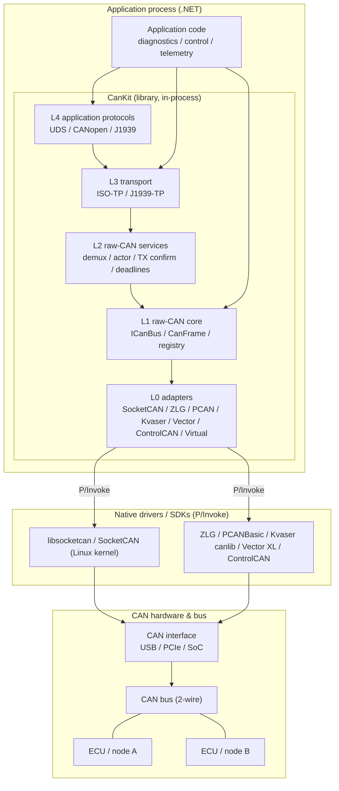

**Neighbouring systems and interfaces:**

| Neighbour | Direction | Interface | Remark |
|-----------|-----------|-----------|--------|
| Application code | in/out | `ICanBus`, `IIsoTpChannel`, endpoint strings | Public API (`CanKit.Abstractions.API.*`). |
| Native drivers | in/out | P/Invoke (`Native/*.cs`) | Per adapter; fake mirror for tests. |
| Vendor SDK NuGets | dependency | package references | Adapter-specific. |
| CAN hardware/ECUs | in/out | CAN/CAN-FD frames | Physical bus; replaced by the `Virtual` hub in tests. |

---

# 4. Solution Strategy

| Quality goal | Approach | Implementation (as-is / target) |
|--------------|----------|---------------------------------|
| Q1 extensibility | **Layer model L0–L4** + **SPI/registry** | L0/L1 (upstream) with reflection-based `CanRegistry` (register×entry pipeline). L2–L4 do **not** attach via the registry but as libraries with static factories (`IsoTp.Open`, `UdsClient.Create`, `CanOpen.OpenNode`, `J1939Node.Open`) on `ICanBus`/`ICanBusService`; the registry remains an L0 mechanism. |
| Q1 extensibility | **Uniform adapter pattern** | As-is: `<Vendor>Bus/Transceiver/Options/Native/Register`; new vendor = new project + `[CanRegistryEntry]` class. |
| Q3 real-time / Q5 resources | **Zero-alloc / pooling** | `CanFrame` = `readonly record struct` with optional `IMemoryOwner<byte>`; `IBufferAllocator` (array pool) — both upstream; the ownership contract (8.1) is only partly implemented there. `CanKit.Pro.IsoTp` constructs no frames with an owner. |
| Q3 real-time | **Platform-dependent high-resolution timing** | As-is: `SoftwarePeriodicTx` (Win waitable timer / POSIX `clock_nanosleep`), `PreciseDelay`, hardware `BCMPeriodicTx` (SocketCAN). Target: add macOS fallback. |
| Q4 testability | **Fake-native + virtual loopback** | Upstream: `*.Fake.cs` per adapter (`-c Fake`), `Virtual` in-memory hub. Here: xUnit suite `tests/CanKit.Pro.Tests`, protocol tests run against the `Virtual` adapter (8.9). |
| Q2 portability | **API on the lowest TFM, P/Invoke encapsulated** | As-is: netstandard2.0-compatible API, `#if` switches. |
| L2–L4 | **Actor model per protocol instance** | Every protocol instance of ISO-TP channel, J1939-TP channel, CANopen node and J1939 node owns exactly one processing "actor" (`CanKit.Pro.Actor`: mailbox/loop), no shared mutable state across thread boundaries. The UDS client does not follow the model: it serialises its requests via a `SemaphoreSlim` (one transaction at a time, ISO 14229-1 §7.3) and uses a `ProtocolActor` at most as an optional time source for P2/P2*. The LSS master (`CanOpenLss.OpenMaster`) works the same way: one command at a time behind a `SemaphoreSlim`, a `ProtocolActor` only as a timer. |

**Guiding decision:** L1 remains the stable, vendor-neutral raw-CAN core. All higher protocols
get their common cross-cutting services **not** ad hoc but bundled in **L2** (demux, ownership,
TX confirm, addressing, actor model, timeout/fault). This closes the four gaps identified in the
review in one central place.

---

# 5. Building Block View

## 5.1 Level 1 – Overall system (L0–L4)

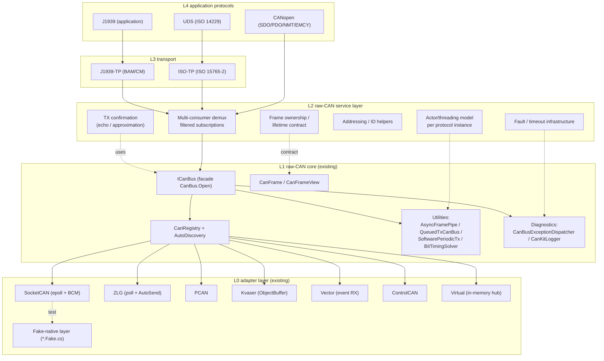

**Short description of the top-level building blocks:**

| Building block | Status | Purpose | Central interface | Fulfils (SRS) |
|----------------|--------|---------|-------------------|---------------|
| L0 adapters | existing | Encapsulate vendor drivers behind `ICanBus`, run the RX loop, execute TX. | `ICanBus`, `ITransceiver`, `ICanDevice` | `FR-RAW-ADAPTER-*` |
| L1 raw-CAN core | existing | Vendor-neutral frame access, discovery, utilities, diagnostics. | `ICanBus`, `CanBus.Open`, `CanRegistry` | `FR-RAW-*` |
| L2 raw-CAN services | existing (`CanKit.Pro.RawCan`, `.Actor`, `.Addressing`, `.Reliability`) | One RX stream → N independent filtered consumers; ownership contract (upstream); TX confirm; actor model. | `ICanBusService` / `ISubscription` | `FR-RAW-DEMUX-*`, `FR-RAW-OWN-*`, `FR-RAW-TXC-*` |
| L3 transport | existing (`CanKit.Pro.IsoTp`, `CanKit.Pro.J1939Tp`) | Segmentation/reassembly (ISO-TP), sessions (J1939-TP). | `IIsoTpChannel`, `IJ1939TpChannel` | `FR-TP-*` |
| L4 application protocols | existing (`CanKit.Pro.Uds`, `.CANopen`, `.J1939`) | Diagnostic/application semantics on L3/L2. CANopen bundles in one package the device (CiA 301, FR-CO-001..028, 052..057), master/tool (peer SDO, foreign PDOs, flying master and boot-up per CiA 302-2, discovery; FR-CO-029..034), safety (CiA 304/319, `SrdoEngine`, ADR-12; FR-CO-035..046, 051, 058..059) and LSS (CiA 305/801, ADR-13; FR-CO-047..050). | `UdsClient`, `ICanOpenNode`, `CanOpenLss`, `J1939Node` | `FR-UDS-*`, `FR-CO-*`, `FR-J1939-*` |

## 5.2 Level 2 – Zoom L1 (raw-CAN core, existing)

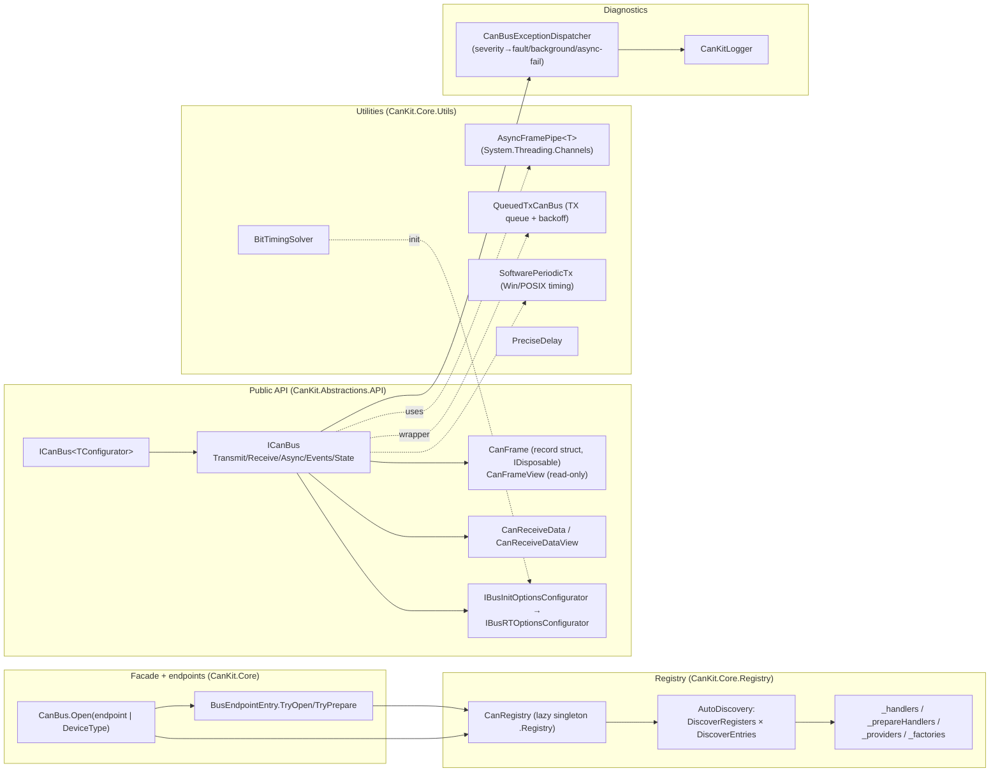

**L1 building blocks (selection):**

| Building block | Purpose | Interface (verified) | Fulfils |
|----------------|---------|----------------------|---------|
| `ICanBus` | Vendor-neutral raw-CAN access. | `Transmit(Span/Array/Enumerable/ArraySegment/in single)`, `TransmitAsync`, `Receive/ReceiveAsync/GetFramesAsync`, `TransmitPeriodic`, `Reset/ClearBuffer`, `BusState`, `ErrorCounters()`, `BusUsage()`, `NativeHandle`; events `FrameReceived` (obsolete), `FrameObserved`, `ErrorFrameReceived`, `BackgroundExceptionOccurred`, `FaultOccurred`. | `FR-RAW-BUS-*` |
| `CanFrame` | Value type for frames, Classic+FD factories, optional owner backing. | `readonly record struct`, `Classic(...)`/`Fd(...)`/`Create(...)`, `Data:ReadOnlyMemory<byte>`, `Flags`, `Dlc`, `Dispose()`. | `FR-RAW-FRAME-*` |
| `CanFrameView` | Read-only projection for observers (no ownership). | `readonly record struct` with `ID/FrameKind/Data/Flags`. | `FR-RAW-OBS-*` |
| `CanRegistry` | Discovery + resolution of providers/factories/endpoints. | `Registry` (lazy singleton), `Resolve(DeviceType)`, `Factory(id)`, `TryOpenEndPoint`, `EnumerateEndPoints`. | `FR-RAW-DISC-*` |
| `AsyncFramePipe<T>` | Decoupling of RX producer (loop) ↔ async consumer. | `Publish`, `ReceiveBatchAsync`, `ReadAllAsync`, `ExceptionOccured`. | `FR-RAW-ASYNC-*` |
| `QueuedTxCanBus` | Optional TX queue wrapper with backoff. | Extension `ICanBus.WithQueuedTx()`. | `FR-RAW-TXQ-*` |
| `CanBusExceptionDispatcher` | Central error classification → fault/background/async-fail. | `Report(exception, source, severity?)`. | `FR-RAW-ERR-*` |

## 5.3 Level 2 – Zoom L2 (raw-CAN service layer)

L2 closes the four central architecture gaps of the first edition. **All building blocks here are implemented** (one package per table row); only the frame ownership contract lies upstream with CanKit.

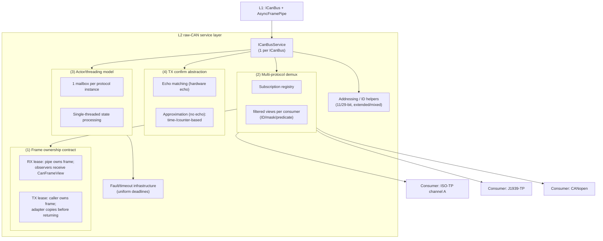

| L2 building block | Gap | Purpose | Interface | Fulfils |
|-------------------|-----|---------|-----------|---------|
| `ICanBusService` | – | One service object per `ICanBus`; holds subscriptions, TX confirm, actors. | `Subscribe(filter) → ISubscription`, `SendConfirmedAsync(frame) → Task<TxConfirmation>` | `FR-RAW-SVC-*` |
| Multi-protocol demux | (2) | One RX stream → N independent filtered consumers, **without** competing `ReceiveAsync`. **Implemented** in the new package `CanKit.Pro.RawCan` (`ICanBusService`/`CanBusService` + `ISubscription`): one bounded drop-oldest channel per subscription (FR-RAW-011), fast path `CanIdFilter` (ID range/mask) beside a generic `Func<CanFrameEvent,bool>` (FR-RAW-010/013), deterministic dispose (FR-RAW-012). The delivered element is `CanFrameEvent` = frame + `IsEcho` + receive timestamp; echoes are delivered only to subscriptions that requested them with `includeEcho: true` (FR-RAW-015, [#23](https://github.com/dborgards/CanKit.Pro/issues/23)). Builds exclusively on `ICanBus.FrameObserved`, no adapter intervention. | `ICanBusService.Subscribe(filter, includeEcho) → ISubscription { IAsyncEnumerable<CanFrameEvent> Frames; }` | `FR-RAW-010..013`, `FR-RAW-015` |
| Frame ownership contract | (1) | Binding lease rules (see 8.1); prevents use-after-free/double-dispose. **Core mechanics implemented** (`OwnMemory` fix, `CanFrame.Duplicate`, virtual-hub broadcast by copy); outstanding (upstream): TX lease for the remaining L0 adapters; the prototype's ISO-TP scheduler, which also needed it, no longer exists. | Contract documentation + `OwnMemory` fix (Review §1.5) | `FR-RAW-OWN-*` |
| TX confirm | (4) | Uniform "sent" confirmation, whether or not a hardware echo exists. **Implemented** in `CanKit.Pro.RawCan` (`ICanBusService.SendConfirmedAsync`): FIFO echo matching per (ID, payload) for concurrent identical sends (FR-RAW-031), documented driver-acceptance approximation without echo (FR-RAW-032), observable failures instead of hanging on timeout/BusOff/rejection (FR-RAW-033), configurable timeout per call (FR-RAW-034). | `TxConfirmation { Confirmed; Timestamp; IsApproximated; FailureReason; }` | `FR-RAW-030..034` |
| Addressing helpers | – | 11/29-bit, extended/mixed/normal-fixed (previously present only as a single special case in `IsoTpEndpoint`). **Implemented** as a standalone, dependency-free package `CanKit.Pro.Addressing`: validated 11-/29-bit ID checks (`CanIdRange`), general J1939 PGN/priority/PDU-format/source-address composition and decomposition (`J1939Id`/`J1939Fields`, FR-RAW-040) — generalises the 29-bit construction from `IsoTpEndpoint.CreateNormalFixed`, which was restricted to one fixed diagnostic PGN. Additionally `CanIdFilter.Overlaps` and `ICanBusService.FindOverlappingFilterSubscriptions()` in `CanKit.Pro.RawCan` for detecting overlapping subscription filters (FR-RAW-041, Should); every hit is reported as a named `FilterOverlap` (both subscriptions plus the shared ID range). | ID construction/decomposition, PGN/priority helpers | `FR-RAW-ADDR-*` |
| Actor/threading model | (3) | Exactly one processing thread/mailbox per protocol instance; no shared mutable state. **Implemented** as a standalone, dependency-free package `CanKit.Pro.Actor` (see ADR-6): event-driven loop (no busy loop, FR-RAW-022), selectable execution context per instance (`ActorExecutionMode`: `DedicatedThread`/`ThreadPool`/`SynchronizationContext`, FR-RAW-024), `BackgroundExceptionOccurred` as the single channel for background errors (FR-RAW-023). Used by `CanKit.Pro.IsoTp` (`IsoTpChannel`), `CanKit.Pro.J1939Tp`, `CanKit.Pro.J1939` and `CanKit.Pro.CANopen`; `CanKit.Pro.Uds` uses it only as an optional time source for P2/P2* and serialises requests itself. | `IProtocolActor { Post(msg); PostAsync(msg); Schedule(delay, cb); }` | `FR-RAW-ACTOR-*` |
| Fault/timeout infrastructure | – | Uniform deadline management (replaces scattered ISO-TP `Deadline`s) and pushed bus fault states. **Implemented** as a standalone package `CanKit.Pro.Reliability` (see ADR-11), built on `CanKit.Pro.Actor`: `IDeadlineScheduler`/`DeadlineScheduler`/`Deadline` is a reusable deadline primitive whose expiry is actually scheduled, checked and reported on the actor loop via `IProtocolActor.Schedule` — fixes the class "deadlines are maintained but never checked" (Review §1.1 item 10, FR-RAW-050); the Pending→{Expired\|Completed\|Cancelled} resolution is decidable exactly once via `Interlocked` CAS, exceptions from `onExpired` go through the existing `BackgroundExceptionOccurred` channel (no second error channel). `BusStateMonitor`/`BusStateChangedEventArgs`/`BusStateExtensions` pushes `ICanBus.BusState` transitions (ErrWarning/ErrPassive/BusOff and recovery) to protocol instances — reliably via a self-rearming poll on the actor's `Schedule` (default 50 ms) instead of a free-running timer, supplemented by `ErrorFrameReceived`/`FaultOccurred` as latency hints (FR-RAW-051). Used by `IsoTpChannel` (N_Bs/N_Cr), `CanKit.Pro.J1939`, `CanKit.Pro.J1939Tp` and `CanKit.Pro.CANopen`. FR-RAW-052 (reserved/invalid protocol values) is deliberately not built as a generic L2 primitive but implemented as the codec task FR-TP-007 in `IsoTpFrameCodec.DecodeStMin` (reserved ranges → 127 ms). | `IDeadlineScheduler`, `DeadlineScheduler`/`Deadline`, `BusStateMonitor`, `BusStateExtensions` | `FR-RAW-050..051` |

## 5.4 Level 2/3 – Zoom L3: ISO-TP internals (`CanKit.Pro.IsoTp`)

The class diagram depicts `CanKit.Pro.IsoTp` (verified against `src/CanKit.Pro.IsoTp`). It replaces
the diagram of the first edition, which showed the fork's prototype — `IsoTpScheduler`, `Router`,
`IsoTpChannelCore`, `TxOperation` and the `Deadline`s that were maintained but never evaluated. None
of these types exists in this repository.

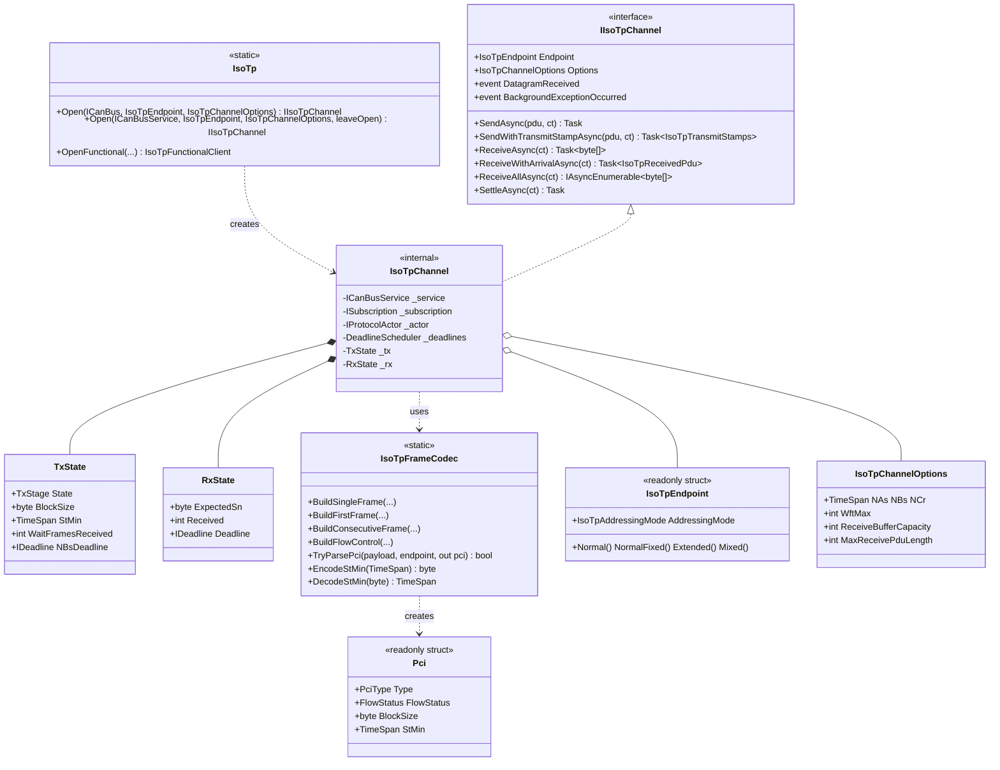

**L3/ISO-TP building blocks (verified):**

| Building block | Purpose | States / core methods | Status |
|----------------|---------|-----------------------|--------|
| `IsoTpChannel` | TX/RX state machine per endpoint; exactly one `ProtocolActor`, RX via an `ICanBusService` subscription, TX via `SendConfirmedAsync`. | TX: `TxStage.SingleOrFirstInFlight/WaitFcInitial/SendingCf/WaitFcBlock`; RX: `_rx` set or `null` (reassembly running/idle). | implemented (FR-TP-001..018) |
| `IsoTpFrameCodec` | Building/parsing of SF/FF/CF/FC, STmin en-/decoding, sequence numbers. | `BuildSingleFrame/FirstFrame/ConsecutiveFrame/FlowControl`, `TryParsePci`, `EncodeStMin/DecodeStMin`. | implemented (FR-TP-003..008) |
| `IsoTpEndpoint` | Address pair and addressing mode. | `Normal`, `NormalFixed`, `Extended`, `Mixed`. | implemented |
| `DeadlineScheduler` (`CanKit.Pro.Reliability`) | N_Bs (FC wait time) and N_Cr (next CF); N_As is provided by `SendConfirmedAsync`. | `Arm`, `Rearm`, expiry on the actor loop. | implemented (FR-TP-010) |
| `IsoTpFunctionalClient` / `IsoTpFunctionalListener` | Functional addressing (1:n requests). | `IsoTp.OpenFunctional(...)`. | implemented (FR-TP-019, Could) |

---

# 6. Runtime View

## 6.1 (a) `CanBus.Open` including registry discovery (as-is)

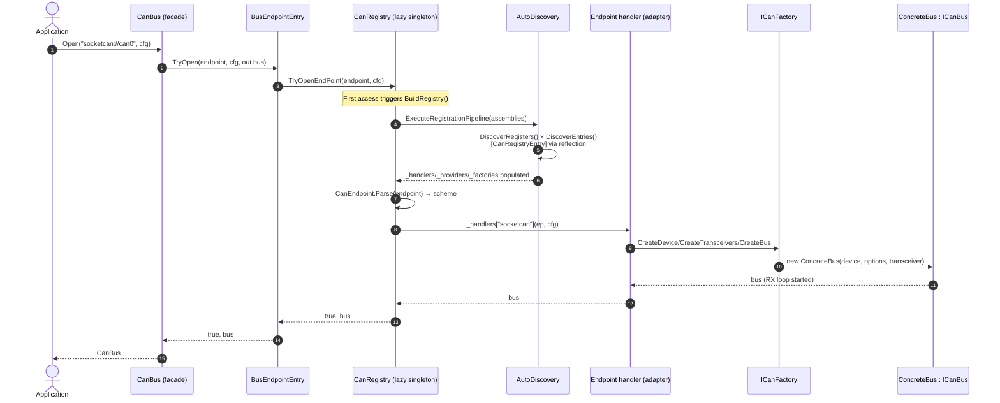

## 6.2 (b) RX path: adapter → demux (L2) → several consumers

The demux (`CanBusService`) attaches exactly once to the `ICanBus.FrameObserved` event (ADR-5). The
`AsyncFramePipe` branch independently serves the direct L1 consumers (`ReceiveAsync`).

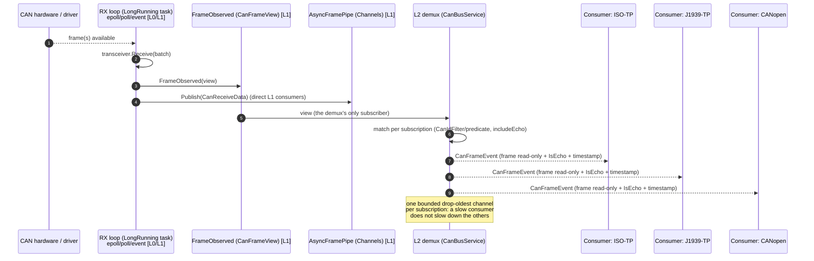

## 6.3 (c) TX path including TX confirm (L2 over L1)

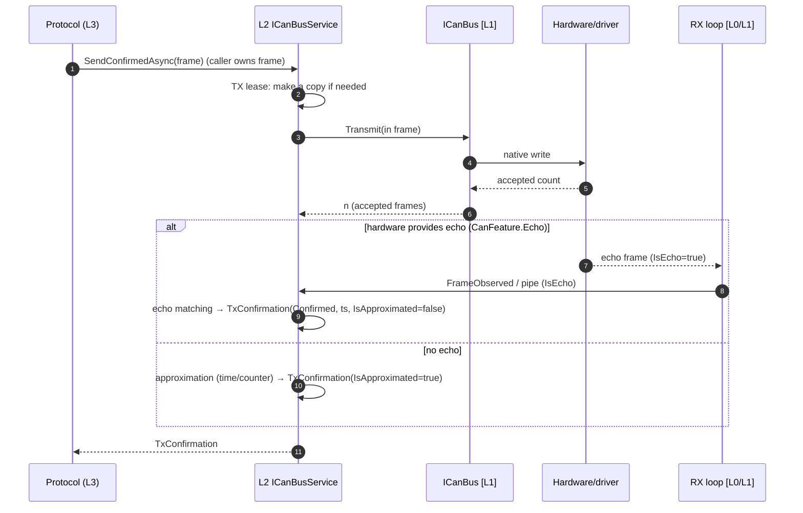

## 6.4 (d) ISO-TP multi-frame transmission (FF → FC/CTS → CF… → PDU)

Sequence per ISO 15765-2 as `IsoTpChannel` executes it: the state lives exclusively on the actor
loop; `SendConfirmedAsync` runs on the thread pool and reports its result back via `Post`, so the
loop never waits on a task.

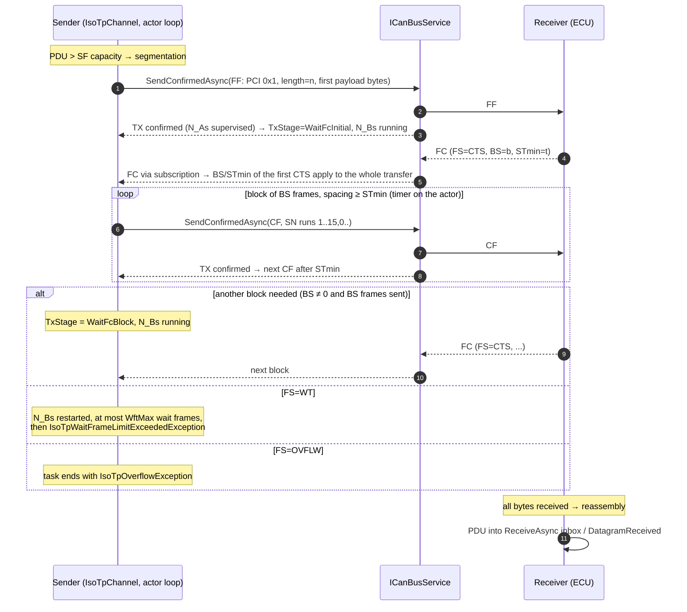

## 6.5 (e) UDS request/response with ResponsePending (0x78) over ISO-TP (L4)

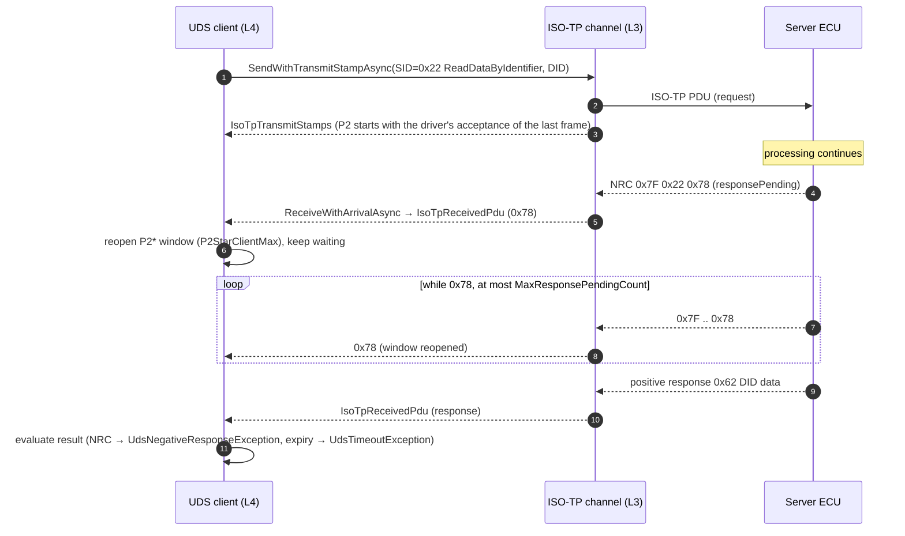

## 6.6 (f) J1939 TP.CM session (L3, `CanKit.Pro.J1939Tp`)

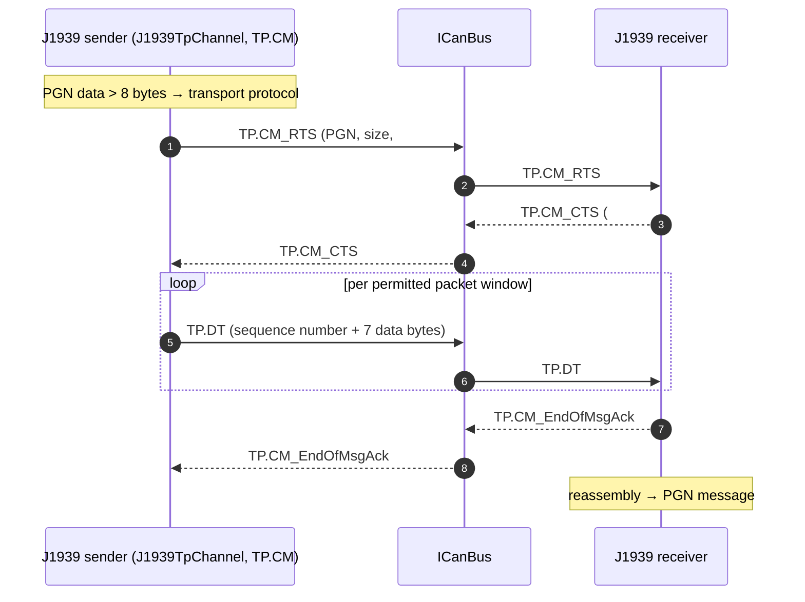

## 6.7 ISO-TP state machine (`IsoTpChannel`)

**TX state machine** (`TxStage` in `IsoTpChannel`; transitions per `HandleRxFlowControl` and the
TX confirmation handlers):

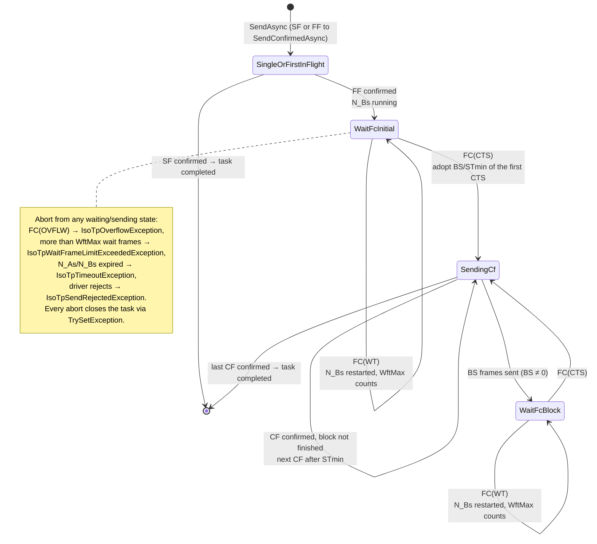

**RX reassembly** (`RxState`; there is no separate enum, "Idle" is `_rx == null`):

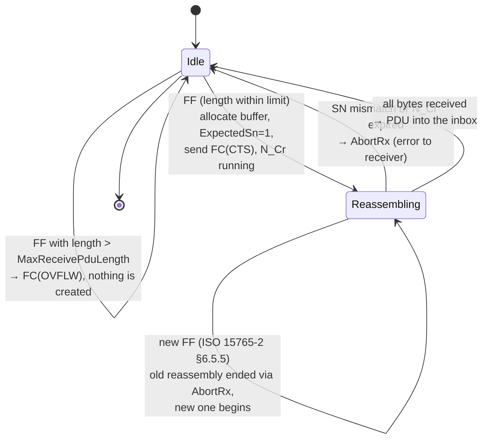

Stray CFs in state `Idle` and CFs whose length does not match the FF are discarded without touching
SN, block counter or N_Cr.

---

# 7. Deployment View

CanKit is an **in-process library** (no process/service of its own). Deployment concerns the
combination of TFM, operating system, native driver and hardware.

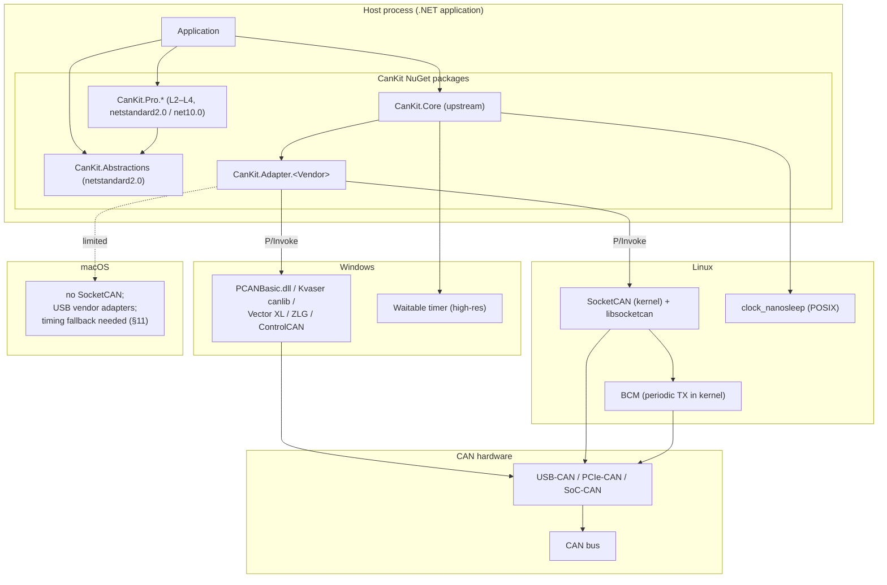

**TFM-/platform-dependent paths:**

The CanKit.Pro packages are pure managed code without P/Invoke and run wherever CanKit runs; the
platform-dependent rows concern L0/L1 and therefore lie upstream. `CanKit.Pro.CANopen` is the only
package that brings one further managed dependency (`EdsDcfNet`, CON-SDK). The `netstandard2.0`
assets are executed under .NET Framework (`net48`) in the test matrix, the `net10.0` assets under
.NET 10.

| Aspect | Windows | Linux | .NET Framework (`netstandard2.0`) | macOS |
|--------|---------|-------|-----------------------------------|-------|
| Preferred adapter | PCAN/Kvaser/Vector/ZLG/ControlCAN | SocketCAN | vendor-dependent | USB vendor adapters |
| Periodic TX (L1) | software (waitable timer) / vendor AutoSend | hardware BCM or software | software | software (fallback missing, §11) |
| High-res delay (L1) | `Win_PreWait` (waitable/spin) | `clock_nanosleep` | platform-dependent | **busy-loop bug** (§11) |
| Protocol-layer timers (L2) | `ProtocolActor` timer queue, event-driven, platform-independent | ditto | ditto | ditto |

---

# 8. Cross-cutting Concepts

## 8.1 Frame ownership / lifetime contract (central!)

`CanFrame` is a `readonly record struct` with optional `IMemoryOwner<byte>` backing and
`IDisposable`. The value is copied, shared via events, passed through the `AsyncFramePipe` and
broadcast to N recipients in the virtual hub. Without a binding contract, **use-after-free** and
**double-dispose** arise (Review §1.5, §2.1).

**As-is state in the fork (fixed in CanKit.Pro.legacy, FR-RAW-001/002/004; not in CanKit 0.5.6, see `docs/upstream-candidates.md` § 2–3):**
- `CanFrame.Dispose()` respects the `OwnMemory` flag and releases the owner only if the frame
  instance is the owner according to the ownership contract (formerly Review §1.5,
  `CanFrame.cs:370`; fixed).
- `CanFrame.Duplicate(IBufferAllocator)` (new) creates an independently viable copy with its own
  rented buffer whose `Dispose()` is decoupled from the original — the concrete primitive with
  which multi-consumer distributors create independent RX leases.
- `VirtualBusHub.Broadcast` no longer passes on the shared sender frame but calls
  `frame.Duplicate(...)` for every recipient (and the echo path), so a consumer that disposes its
  copy immediately can no longer invalidate the sender or other consumers (formerly Review §2.1,
  VirtualBusHub use-after-free; fixed, test `VirtualBusOwnershipTests` in the predecessor
  repository — it exercises CanKit internals that the published package does not expose).
- `VirtualBusHub._hubs` now removes empty hubs when the last member leaves
  (`VirtualBusHub.Detach`/`Join`, atomically under a shared registry lock) instead of growing
  without bound (formerly Review §2.4; fixed).

**Still open:** None of these fixes is contained in the consumed CanKit 0.5.6; until they land
upstream, `CanKit.Pro.RawCan` relies on `FrameObserved` delivering a `CanFrameView` and constructs
no frames with an owner itself. Event observers (`FrameReceived`, deprecated) still receive the
disposable `CanFrame` instead of only a `CanFrameView`, which permits misuse (migration to
`FrameObserved` is under way, but `FrameReceived` remains for compatibility). The TX lease
principle (3) is implemented for the Virtual adapter; for the remaining L0 adapters the
implementation is outstanding (`FR-RAW-005`, Should). The prototype's ISO-TP scheduler, whose echo
matching Review §2.1 ("Scheduler (ISO-TP)") criticised, no longer exists; `IsoTpChannel` constructs
no `CanFrame` instances with an owner and confirms via `SendConfirmedAsync`.

**Target contract (L2, `FR-RAW-OWN-*`):**

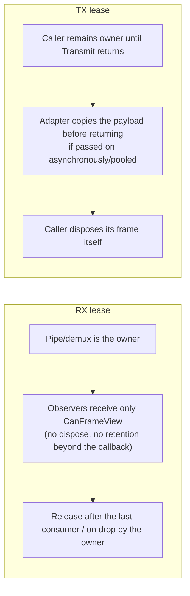

Rules: (1) `Dispose()` only when `OwnMemory==true`. (2) RX frames belong to the pipe; event
observers get a `CanFrameView` and must not hold it beyond the callback. (3) TX frames belong to
the caller; adapters that keep referencing the frame after `Transmit` (echo matching, BCM)
**copy** beforehand. The prerequisite is the `OwnMemory` fix (Review §1.5, recommendation 2).

## 8.2 Error and exception handling

The central building block is `CanBusExceptionDispatcher.Report(exception, source, severity?)`.
It classifies via `CanExceptionPolicy` into thresholds and derives:

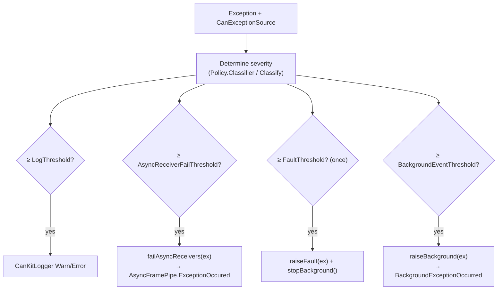

The separation of **Fault** (terminal, stops loops), **Background** (notification) and
**Async-Fail** (wakes waiting consumers) is a sound as-is concept. Weakness: subscriber callback
exceptions are processed again per adapter via `Report` (good). The fork prototype's ISO-TP
scheduler threw inside the handler (`OnBackgroundExceptionOccurred`); it no longer exists. In
CanKit.Pro, background errors of a protocol instance go through
`IProtocolActor.BackgroundExceptionOccurred` (ADR-6), surfaced on `IIsoTpChannel` as
`BackgroundExceptionOccurred`.

## 8.3 Concurrency & threading model (actor model)

**L1 (upstream):** one background RX loop per bus (epoll/poll/event) on a `LongRunning` task;
`AsyncFramePipe` (System.Threading.Channels) decouples the RX producer from async consumers;
`QueuedTxCanBus` is an optional TX queue wrapper. The higher protocols of the fork prototype
mutated state (`_tx`, `_pendingOperations`, `Router._channels`) across thread boundaries without
synchronisation (Review §1.1/14) — the starting point for the actor model.

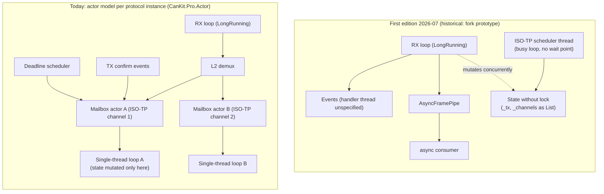

**Actor model (`FR-RAW-ACTOR-*`, implemented):** Every protocol instance owns exactly **one
mailbox** and one **single-threaded processing loop**. RX frames, TX confirmations and deadline
ticks are posted as messages into the mailbox; the state is mutated exclusively in the actor loop.
This removes the former data races, and the busy loop is replaced by event-driven waiting
(`SemaphoreSlim.Wait`/`WaitAsync`) (review recommendation 6). Implemented as a standalone
`IProtocolActor`/`ProtocolActor` in `CanKit.Pro.Actor`, depending on no other CanKit package (see
ADR-6). Every protocol instance of `IsoTpChannel`, `CanKit.Pro.J1939Tp`, `CanKit.Pro.J1939` and
`CanKit.Pro.CANopen` uses it; the UDS client instead serialises its requests via a `SemaphoreSlim`
and uses a `ProtocolActor` only as an optional time source for P2/P2*.

## 8.4 Resources & pooling

`IBufferAllocator` (default and ArrayPool variant) supplies `IMemoryOwner<byte>` for frame
payloads; `CanFrame` owner factories take it optionally. Target: pooling only in conjunction with
the ownership contract (8.1), otherwise use-after-free. The fork prototype's `FrameCodec` violated
this (`ArrayPool.Rent` without return, `Rent(8)` yields 16 bytes → validate throw, Review
§1.1/13); `IsoTpFrameCodec` instead returns plain `byte[]` or writes into caller-supplied
`Span<byte>` targets and rents nothing.

## 8.5 Configuration / options

Two-stage: **Init** (`IBusInitOptionsConfigurator`, fluent: `Baud/Fd/SetFilter/
SetWorkMode/BufferAllocator/ExceptionPolicy/…`) → **Runtime** (`IBusRTOptionsConfigurator`,
read-only access to `BitTiming`, `Filter`, `Features`, `AsyncBufferCapacity`, `ExceptionPolicy`).
Each adapter has its own option types; `CallOptionsConfigurator<TOption,TSelf>` is the generic
base. `CanFeature` flags + software fallback (`SoftwareFeaturesFallBack`) allow missing hardware
capabilities to be replaced in software.

## 8.6 Logging / diagnostics

`CanKitLogger` is the central logging facade (Warn/Error), used best-effort by the dispatcher.
`NativeHandle` (`BusNativeHandle`) enables interop diagnostics. Debt: the mixed time base
(`DateTime.Now` vs. `UtcNow`) hampers correlation (Review §2.5).

## 8.7 High-resolution timing (platform-dependent)

`SoftwarePeriodicTx` selects the timing path at runtime: Windows → waitable timer + spin finish
(`Win_PreWait`), POSIX → `clock_nanosleep`. `PreciseDelay` and the `BitTimingSolver` (sample
point → BRP/TSEG) complement it. SocketCAN additionally uses the kernel **BCM** for near-hardware
periodic TX. Debt: macOS has no `clock_nanosleep`; the error is swallowed → busy loop (Review
§2.3). Target: `OperatingSystem.IsMacOS()` fallback to `Thread.Sleep`.

## 8.8 Extensibility via SPI (registry pipeline)

Adapters register declaratively: a class annotated with `[CanRegistryEntry]` implements
markers/contracts (`ICanRegisterFactory`, `ICanRegisterProviders`, `IRawRegisterEndpoint`). The
**register×entry pipeline** (`ExecuteRegistrationPipeline`) collects via reflection all
`ICanRegister` (adapter contexts) and all `ICanRegistryEntry` (registration logic, e.g.
`RegisterProvidersEntry`, `RegisterFactoriesEntry`, `RegisterEndpointsEntry`) and executes every
entry against every register in `Order`.

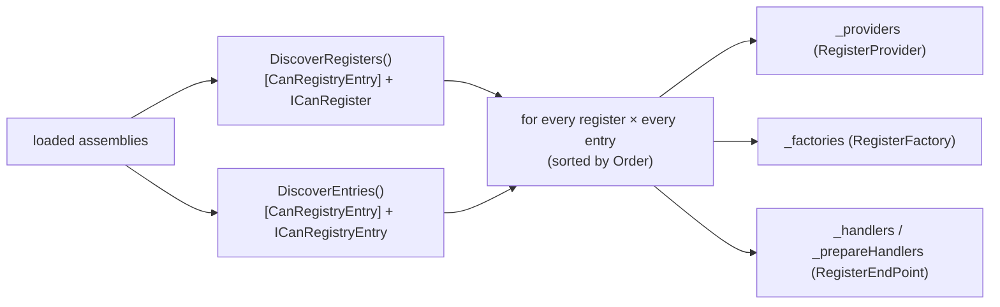

The first edition intended L3/L4 (ISO-TP, UDS, …) to attach via the same mechanism
(`IIsoTpRegister`). That was **not** implemented that way: the CanKit.Pro packages are libraries
with static factories (`IsoTp.Open`, `UdsClient.Create`, `CanOpen.OpenNode`, `J1939Node.Open`) on
`ICanBus`/`ICanBusService` or, for the UDS client, on an `IIsoTpChannel`; they need neither a core
change nor a registry entry. NFR-010 (SRS) therefore demands exactly this pattern — standalone
package, static factory on the layer directly below, no change to `CanKit.Core`, no vendor SDK —
and no registration ([#226](https://github.com/dborgards/CanKit.Pro/issues/226)). The registry
remains the mechanism of the L0 adapters: it resolves an endpoint string into an opened bus. A
protocol package sits on an already open bus and has no such name, and the reflection cost
(ADR-1) would travel along without benefit.

## 8.9 Test strategy (virtual loopback / fake)

Two levels: (1) **Fake-native** – every `Native/*.cs` has a `*.Fake.cs` mirror; with `-c Fake`
(`DefineConstants=FAKE`) the CI builds/tests without hardware. (2) **Virtual adapter** – an
in-memory `VirtualBusHub` connects several `VirtualBus` instances into a loopback network for
protocol tests. xUnit **matrix tests** (`tests/CanKit.Tests/Matrix`) check adapters uniformly
(upstream). This repository holds the xUnit suite `tests/CanKit.Pro.Tests`; the protocol tests
run against the `Virtual` adapter. The ISO-TP gap from Review §4 is closed:
`tests/CanKit.Pro.Tests/TestCases/IsoTp` covers codec, channel and timeouts; beside it
`TestCases/CANopen` (with `Lss`, `Safety`), `J1939`, `Uds` and property-based tests under
`Properties`. Because the published `Virtual` adapter does not mark its echo with `IsEcho`,
echo-dependent tests run in three "echo worlds" (`Infrastructure/EchoWorlds.cs`: flagged,
unflagged, flagged in normal mode). Time-dependent tests are being moved onto the actor's virtual
clock instead of measuring against the wall clock (#92, #171). The suite runs on `net10.0`; the
Windows leg of `ci.yml` additionally runs it on `net48`, where the `netstandard2.0` assets actually
execute. `eng/verify-requirements-traceability.py` checks that every `Must` requirement of the SRS
is referenced by at least one test.

---

# 9. Architecture Decisions (ADRs)

### ADR-1: Reflection-based registry with register×entry pipeline
- **Context:** Adapters/protocols should attach without core changes; consumers want
  `CanBus.Open("scheme://…")` without manual registration.
- **Decision:** Lazy singleton `CanRegistry.Registry` scans loaded assemblies via reflection for
  `[CanRegistryEntry]` and runs a register×entry pipeline (`ExecuteRegistrationPipeline`).
- **Consequences:** + high extensibility (Q1), plug-in character. − reflection/loading cost on
  first access; trimming/AOT made harder; `Dictionary` without lock (existing debt, §11).

### ADR-2: `CanFrame` as `readonly record struct` with optional `IMemoryOwner`
- **Context:** Zero-alloc frames (Q5) with optional pooled backing at the same time.
- **Decision:** Value type with `Data:ReadOnlyMemory<byte>`, `OwnMemory` flag and `Dispose()`;
  read-only view `CanFrameView`.
- **Consequences:** + low allocation, clear read-only projection. − ownership across
  copies/broadcasts hard to control; `Dispose()` ignores `OwnMemory` today (§11) → forces the
  ownership contract (ADR-9).

### ADR-3: `System.Threading.Channels` (`AsyncFramePipe`) for RX decoupling
- **Context:** The RX loop (synchronous, LongRunning) has to serve async consumers without blocking.
- **Decision:** `AsyncFramePipe<T>` wraps a bounded/unbounded `Channel<T>` with `DropOldest` and
  an exception pulse.
- **Consequences:** + clean producer/consumer separation, backpressure policy. − frame loss on
  background errors (orphaned reader), inconsistent cancellation contract (§11).

### ADR-4: ISO-TP as a separate transport package
- **Context:** ISO-TP is optional and has to mature independently of the core; avoid vendor-SDK coupling.
- **Decision:** Own package (L3), independent of the core. The first edition called it
  `CanKit.Transport.IsoTp`; it is implemented as `CanKit.Pro.IsoTp`.
- **Consequences:** + core stays lean, independent release cadence (all CanKit.Pro packages are
  versioned together). − the prototype's erroneous `Peak.PCANBasic.NET` reference and
  `Description=TODO` (§11) no longer exist in the rewrite.
- **Status:** Implemented as `CanKit.Pro.IsoTp` — codec, actor-driven `IIsoTpChannel` (on
  `CanKit.Pro.RawCan`, `.Actor`, `.Reliability`) and functional addressing (§5.4).

### ADR-5 (implemented): L2 demux instead of competing `ReceiveAsync`
- **Context:** Several protocols want to see the same RX stream; today `ReceiveAsync` calls compete
  for the same frames.
- **Decision:** L2 introduces a subscription demux: one RX stream → N independent, filtered
  read-only views.
- **Consequences:** + several protocol stacks in parallel on one bus (Q1). − additional layer,
  broadcast cost; requires the ownership contract (ADR-9).
- **Status:** Implemented in the new package `CanKit.Pro.RawCan` (`ICanBusService`/`CanBusService`,
  `ISubscription`, `CanIdFilter`). The demux listens exactly once on `ICanBus.FrameObserved` and
  fans every `CanFrameView` out lock-free (copy-on-write snapshot of the subscription registry) to
  all subscriptions; each subscription owns its own bounded drop-oldest channel, so a slow/blocked
  subscription delays neither the others nor the base event (FR-RAW-011). `Subscribe` offers a
  generic predicate and an allocation-free `CanIdFilter` fast path (FR-RAW-010/013); `Dispose`
  unsubscribes deterministically and closes the channel (FR-RAW-012), disposing the service
  detaches from the `FrameObserved` event. Builds purely on the existing `ICanBus` surface — no
  adapter intervention. Secured via virtual loopback
  (`tests/CanKit.Pro.Tests/TestCases/RawCanSubscriptionTests.cs`). Open: runtime reconfiguration
  of the filter criteria (FR-RAW-014, Could) is deliberately not part of this implementation.

### ADR-6 (implemented): Actor model per protocol instance
- **Context:** The ISO-TP prototype mutates state across thread boundaries without sync (data races, busy loop).
- **Decision:** Every protocol instance = 1 mailbox + 1 single-threaded loop; RX/TX confirm/
  deadlines as messages.
- **Consequences:** + deterministic threading (Q3/Q4), no lock zoo. − rewrite instead of
  refactoring the ISO-TP core; latency from the mailbox hop.
- **Status:** Implemented as a standalone package `CanKit.Pro.Actor` (`IProtocolActor`/
  `ProtocolActor`), without a dependency on any other CanKit package — a pure, reusable
  single-writer executor plus event-driven timer queue that protocol layers (ISO-TP, J1939,
  CANopen, …) embed. Exactly one `ConcurrentQueue<Action>` mailbox and one timer list sorted by
  due time are mutated exclusively by the currently running loop thread (no lock needed,
  FR-RAW-020/021). The loop blocks on a `SemaphoreSlim` waiting for either new mailbox work or the
  next timer due time, whichever comes first — no polling, no busy loop (FR-RAW-022). The execution
  context is selectable per instance (`ActorExecutionMode`, FR-RAW-024): `DedicatedThread`
  (default, one real `Thread` for the whole lifetime — measurably the same thread for every
  callback, see test), `ThreadPool` (no dedicated thread, but still strictly single-writer) or
  `SynchronizationContext` (every callback is redirected via `SynchronizationContext.Post` to a
  context supplied by the caller, e.g. a UI dispatcher). Background errors from `Post`/`Schedule`
  items are caught and reported via `BackgroundExceptionOccurred`; the loop continues afterwards
  (FR-RAW-023) — `PostAsync`/`PostAsync<T>` failures instead go through the returned task, since
  the caller observes it via `await` anyway. `Dispose` rejects new work immediately
  (`ObjectDisposedException`) but still runs already queued work to completion instead of leaving
  a `PostAsync` task waiting at dispose time hanging indefinitely. The ISO-TP prototype
  (functionally defective, Review §1.1, including a 100 % CPU busy loop and unsynchronised `List`
  states) no longer exists; its successor `IsoTpChannel` and the J1939, J1939-TP and CANopen
  packages run on `ProtocolActor`. Secured via unit/concurrency test
  (`tests/CanKit.Pro.Tests/TestCases/ProtocolActorTests.cs`), including parallel `PostAsync`
  access from real OS threads without data loss.

### ADR-7 (implemented): TX confirm abstraction
- **Context:** Some hardware provides a TX echo (`CanFeature.Echo`), some does not; protocols need a
  "sent" signal (N_As).
- **Decision:** Uniform `TxConfirmation` in L2; echo matching where available, otherwise
  approximation (`IsApproximated=true`).
- **Consequences:** + protocol-independent confirm semantics. − the approximation is imprecise
  (jitter) and has to be documented.
- **Status:** Implemented in `CanKit.Pro.RawCan` (`ICanBusService.SendConfirmedAsync`). Use of echo
  matching depends on **two** conditions: `CanFeature.Echo` (hardware capability) AND
  `WorkMode == ChannelWorkMode.Echo` (session opt-in) — the mere presence of the capability is not
  enough. Pending confirmations are kept FIFO per (ID, payload) key in a `LinkedList<PendingSend>`,
  so several concurrent, identical sends are each confirmed individually (not cross-confused)
  (FR-RAW-031) — exactly the error class the review named as the `QueuedDeadline.Enqueue` crash on
  identical frames. Failures (timeout, BusOff, rejection by the driver) resolve the returned task
  observably (`TxConfirmation.FailureReason`), never hang indefinitely; explicit caller
  cancellation runs separately via task cancellation. `BusState.BusOff` triggers, via
  `ICanBus.FaultOccurred`, a proactive fast-fail of all open confirmations instead of waiting for
  the full timeout. `CanKit.Adapter.Virtual` did not previously declare `CanFeature.Echo`
  statically (unlike all real adapters) and was extended for that in the fork — otherwise echo
  matching would not have been testable at all for want of hardware-independent CI. That addition
  is not in CanKit 0.5.6 (`docs/upstream-candidates.md` § 3); the tests here therefore create the
  echo worlds themselves (§8.9). Secured via virtual loopback
  (`tests/CanKit.Pro.Tests/TestCases/TxConfirmTests.cs`).
  **Limitation (measured, #249):** Echo matching requires the adapter to report the own frame with
  `IsEcho`. PCAN delivers it unflagged in echo mode, Kvaser (CanKit 0.5.6) not at all on a quiet
  bus; there every confirmation runs into the timeout. With these adapters normal mode with
  approximated confirmation applies (`docs/reviews/2026-10-06-echo-hardware-measurements.md`).
  J1939 recognises a flagged echo of its own address claim outside echo mode as well.

### ADR-8: Fake-native + virtual loopback as test strategy
- **Context:** CI without CAN hardware, deterministic protocol tests.
- **Decision:** `*.Fake.cs` per adapter (`-c Fake`) + in-memory `Virtual` hub.
- **Consequences:** + hardware-free matrix CI (Q4). − fake reproduces timing/error cases only to
  a limited extent; the virtual hub has ownership/leak debt today (§11).

### ADR-9 (partly implemented): Binding frame ownership/lifetime contract
- **Context:** Shared `CanFrame` values with owner → use-after-free/double-dispose.
- **Decision:** RX lease (pipe owns; observers → view), TX lease (caller owns; adapter copies);
  `Dispose()` respects `OwnMemory`.
- **Consequences:** + safe foundation for L2–L4 (Q1/Q5). − requires adaptation of pipe,
  QueuedCanBus, virtual hub (and at the time the ISO-TP scheduler).
- **Status:** `Dispose()`/`OwnMemory` and virtual hub (`CanFrame.Duplicate`, broadcast copy,
  `_hubs` leak fix) are implemented **in the fork** and secured there via unit/virtual-loopback
  tests (`CanFrameTests`, `VirtualBusOwnershipTests` in the predecessor repository). They are
  absent from the consumed CanKit 0.5.6; `docs/upstream-candidates.md` § 2 lists them as upstream
  candidates. Open: adoption upstream; TX lease copy in the remaining L0 adapters; the ISO-TP
  scheduler, which also needed it, no longer exists.

### ADR-10 (implemented): Addressing helpers as a standalone package
- **Context:** 11-/29-bit ID and J1939 PGN logic existed only as a single special case tailored to
  one diagnostic PGN in `IsoTpEndpoint.CreateNormalFixed` (`Build29`), without general
  decomposition and without reusability for other protocol layers (review: "addressing/ID helpers"
  missing).
- **Decision:** Pure, dependency-free helper functions in an own package `CanKit.Pro.Addressing`,
  separate from `CanKit.Pro.RawCan`/`CanKit.Pro.Actor`, since the logic concerns neither frame
  dispatch nor threading but is pure bit arithmetic on `uint` IDs.
- **Consequences:** + reusable for ISO-TP/J1939/CANopen without coupling to RawCan/Actor. − one
  more small package in the solution.
- **Status:** Implemented: `CanIdRange` (validated 11-/29-bit checks, FR-RAW-040) and
  `J1939Id`/`J1939Fields` (general PGN/priority/PDU-format/PDU-specific/source-address composition
  and decomposition including PDU1/PDU2 distinction and derived destination address, FR-RAW-040) —
  generalises the fork prototype's `IsoTpEndpoint.Build29`. `IsoTpEndpoint` in `CanKit.Pro.IsoTp`
  no longer contains its own 29-bit composition: `NormalFixed(txCanId, rxCanId)` takes finished IDs
  that are built with `J1939Id`. Additionally `CanIdFilter.Overlaps` and
  `ICanBusService.FindOverlappingFilterSubscriptions()` in `CanKit.Pro.RawCan` (FR-RAW-041,
  Should): detects overlapping range/mask filters among the currently registered subscriptions as
  a diagnostic aid for misconfigured protocol instances. Every hit is a `FilterOverlap` — the two
  subscriptions (symmetric, hence `A`/`B` instead of `First`/`Second`) and the shared ID range,
  for mask filters as the enclosing hull of a scattered set. All combinations go through the same
  bitwise search (O(bit width), no enumeration of individual ID values), which directly yields the
  smallest and largest common ID rather than only their existence. Secured via unit tests
  (`tests/CanKit.Pro.Tests/TestCases/AddressingTests.cs`,
  `tests/CanKit.Pro.Tests/TestCases/CanIdFilterOverlapTests.cs`, including a comparison against a
  brute-force sweep of the whole 11-bit ID space).

### ADR-11 (implemented): Fault/timeout infrastructure as a standalone package
- **Context:** L3 protocols need time-bound state transitions (ISO-TP N_Bs/N_Cr, J1939, UDS P2,
  CANopen SDO timeouts) and must know bus fault states (`ErrWarning`/`ErrPassive`/`BusOff`) in
  order to abort/pause active transfers in a controlled way. The ISO-TP prototype maintained
  `Deadline` values but never checked their expiry (Review §1.1 item 10: "deadlines are maintained
  but never checked"), and `ICanBus.BusState` has no change event.
- **Decision:** A reusable, actor-driven infrastructure in an own package `CanKit.Pro.Reliability`,
  built exclusively on `CanKit.Core` (for `ICanBus`/`BusState`) and `CanKit.Pro.Actor` (for
  `IProtocolActor`) — separate from `CanKit.Pro.RawCan`, since it concerns neither frame demux nor
  TX confirm. Deadlines are **not** realised as standalone timers with their own thread but are
  scheduled via `IProtocolActor.Schedule` on the actor loop every protocol instance has anyway
  (FR-RAW-020); likewise the bus state check runs as a self-rearming poll on the same `Schedule`
  instead of a free-running timer/busy loop.
- **Consequences:** + a deadline's expiry is demonstrably scheduled and checked (fixes the error
  class from Review §1.1 item 10), resolved exactly once via `Interlocked` CAS
  (`Pending → Expired|Completed|Cancelled`), and exceptions from `onExpired` use the actor's
  existing `BackgroundExceptionOccurred` channel instead of a second error channel; + bus state
  transitions (including recovery, e.g. `BusOff → ErrActive`) are pushed edge-triggered, without a
  busy loop. − one more small package in the solution; − the `BusState` getter runs synchronously
  on the instance loop per poll tick (deliberate trade-off, see README). The `Rearm` behaviour is
  only "best-effort" when racing against an already dispatched fire (secured via generation
  counter against double firing of timers that have gone stale), analogous to the actor's
  documented `Schedule` caveat.
- **Status:** Implemented: `IDeadlineScheduler`/`DeadlineScheduler`/`Deadline` (FR-RAW-050) and
  `BusStateMonitor`/`BusStateChangedEventArgs`/`BusStateExtensions` (FR-RAW-051), secured via
  unit/virtual-loopback tests (`tests/CanKit.Pro.Tests/TestCases/DeadlineTests.cs`,
  `tests/CanKit.Pro.Tests/TestCases/BusStateMonitorTests.cs`). The primitive is **reusable L2
  infrastructure** and is used by `IsoTpChannel` (N_Bs, N_Cr), `CanKit.Pro.J1939`,
  `CanKit.Pro.J1939Tp` and `CanKit.Pro.CANopen`; the prototype's ISO-TP scheduler, which
  maintained `Deadline`s without evaluating them, no longer exists. FR-RAW-052 (reserved/invalid
  protocol values, e.g. reserved ISO-TP STmin values) is deliberately **not** implemented here but
  as a protocol-codec-specific task in `IsoTpFrameCodec.DecodeStMin` (FR-TP-007, Review §1.1
  item 6) — a generic "reserved value" abstraction would have been speculative.

### ADR-12 (implemented): CANopen Safety (CiA 304) in the CANopen package, as its own engine class
- **Context:** CiA DSP 304 adds SRDO, GFC and the objects 1300h–13FFh to CiA 301. Everything an
  implementation needs — actor, deadline scheduler, bus subscription, validator chain, NMT
  transitions, EDS path — is internal to `CanOpenNode`; extending `ICanOpenNode` would break every
  implementer since 1.3.0 (SemVer). The precedent for the route via an extension method is
  `DisposeAsync` (`c636a17`).
- **Decision:** In the package `CanKit.Pro.CANopen` (no package of its own: a public extension SPI
  would be a second design project and would freeze a plug-in API nobody else uses; precedent CiA
  302-2 and CiA 306). Runtime as `Safety/SrdoEngine` with injected `IProtocolActor`,
  `IDeadlineScheduler`, `ObjectDictionary` and host callbacks (`ISrdoEngineHost`), following the
  pattern of `HeartbeatProducer`/`HeartbeatConsumer`; the objects are managed communication
  objects following the PDO pattern. Public API as `ICanOpenSafety` via
  `CanOpenSafetyExtensions.Safety(this ICanOpenNode)`. Opt-in via `SrdoCount` or a device
  description with SRDO records.
- **Consequences:** + no major release (the 1.3.0 signature of `CanOpenNodeOptions.With` remains as
  an overload beside the one extended by the SRDO options), one package, one time source for all
  deadlines, engine testable without a bus; − the CANopen package grows; − the normative basis is
  DSP 304 V1.0, the reconciliation against EN 50325-5 is outstanding (#289). Decision record:
  `docs/reviews/2026-10-09-canopen-safety-scope.md`.
- **Status:** Implemented as FR-CO-035..046; the configuration entity per CiA 319 v2.0.0 (identity
  verification, storage, SRVT default) as FR-CO-051 (#310, 2026-10-19); the device side per CiA
  319 §5.3/§5.4 (recalculation on the A5h write, download indication, periodic check via
  `SrdoConfigurationCheckInterval`, start-up comparison) as FR-CO-058..059 (#329, 2026-10-20). Not
  built: clauses 7/8 (safety application layer of the profiles), diverse redundancy and the safe
  state (README § "Not built, and why"); reconciliation against EN 50325-5 is outstanding (#289).

### ADR-13 (implemented): Master/tool role, flying master and LSS in the CANopen package
- **Context:** After the device role (FR-CO-013..028) came capabilities a tool or an NMT master
  needs: SDO access to peers checked against their EDS/DCF, observing foreign PDOs, flying master
  and boot-up manager per CiA 302-2 version 4.1.0, node discovery
  (`docs/reviews/2026-09-26-canopen-master-tool-scope.md`, #131), later LSS per CiA 305 v3.0.0
  and bit-rate detection per CiA 801. Each of these could have been a package of its own.
- **Decision:** Everything in the package `CanKit.Pro.CANopen`, as partial classes of
  `CanOpenNode` (`CanOpenNode.FlyingMaster.cs`, `.BootUp.cs`, `.PeerSdo.cs`, `.ForeignPdo.cs`) or
  as standalone types on the same `ICanBusService` (`CanOpenDiscovery`, `CanOpenLss.OpenMaster` →
  `ILssMaster`, `LssCommissioning`, `LssBitRateDetection`). The LSS slave sits in the node
  (`CanOpenNodeOptions.Lss`, `LSS_Supported` from the EDS/DCF) and holds NMT, heartbeat and LSS
  replies back in a queue during the switch delays (#331). The LSS master follows the UDS pattern
  (one command at a time behind a `SemaphoreSlim`, actor only as timer), not the node's actor
  model.
- **Consequences:** + one object dictionary, one actor and one time source for device, master and
  safety; a node-ID change via LSS retargets the node's pre-defined COB-IDs; no public extension
  SPI that would have to be frozen (ADR-12). − the package is the largest in the solution and its
  description in the `.csproj` by now lists every profile; − CiA 302 is members-only, the
  implementation follows the public descriptions of edition 4.1.0 (README § "Flying master").
- **Status:** Implemented as FR-CO-029..034 (master/tool), FR-CO-047..050 (LSS master, slave,
  commissioning, CiA 801; #304, #305, #306, #309, #331). Not built: bit-rate detection as an LSS
  command (index 9 is rejected by the slave), switching the open channel's bit rate without an
  adapter callback (README § "Not built, and why").

---

# 10. Quality Requirements

## 10.1 Quality tree

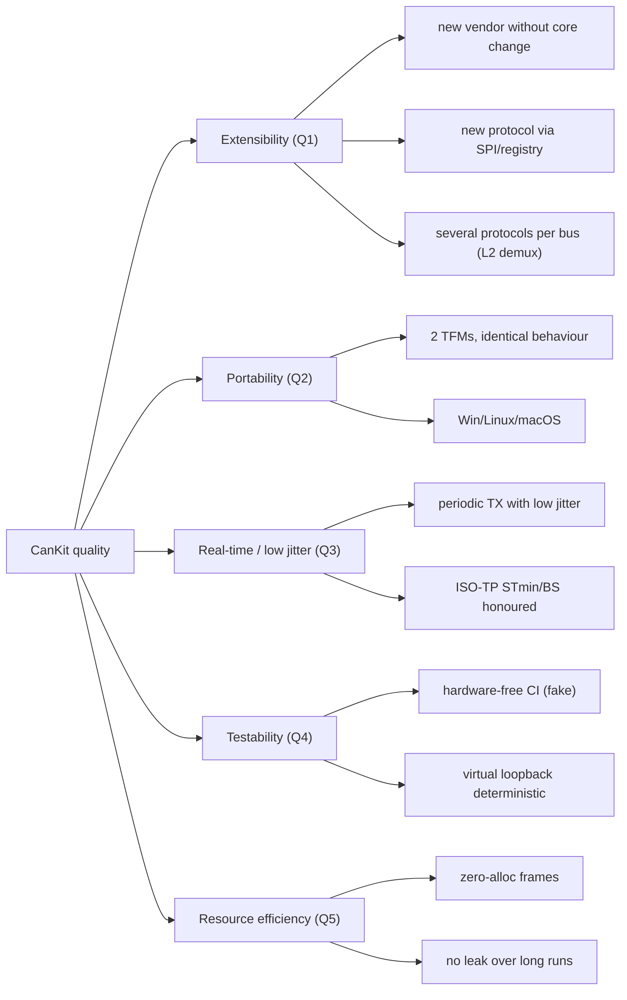

## 10.2 Quality scenarios (stimulus / response / measure)

| ID | Quality | Scenario (stimulus → response) | Measure | SRS |
|----|---------|--------------------------------|---------|-----|
| QS-1 | Extensibility | Developer adds a new vendor adapter as its own project with `[CanRegistryEntry]` → bus can be opened via `scheme://` without core change. | 0 changed core files; adapter running in ≤ 1 day. | NFR-EXT-1 |
| QS-2 | Extensibility | Two protocols (ISO-TP + CANopen) run simultaneously on one bus → both receive their filtered RX stream. | No lost frames; no competing `ReceiveAsync`. | FR-RAW-DEMUX-1 |
| QS-3 | Real-time | Periodic TX with a 1 ms period over 60 s on Windows. | Jitter p99 ≤ defined limit; no busy-loop CPU load. | NFR-RT-1 |
| QS-4 | Real-time | ISO-TP sender with STmin=10 ms, BS=8 → CF spacing honoured. | Mean CF spacing ∈ [STmin, STmin+tolerance]. | FR-TP-STMIN |
| QS-5 | Portability | Identical test case on `netstandard2.0` (executed under .NET Framework, `net48`) and `net10.0`. | Green test matrix on both legs. | NFR-PORT-1 |
| QS-6 | Testability | CI run without attached hardware (`-c Fake`). | All adapter suites green without devices. | NFR-TEST-1 |
| QS-7 | Resource efficiency | 24 h endurance run with RX/TX load. | Constant memory (no hub/event leak); no use-after-free crashes. | NFR-RES-1 |
| QS-8 | Robustness | Faulty peer sends reserved STmin/length values. | No crash in the RX path; reserved values → treated as 127 ms. | FR-TP-ROBUST |

---

# 11. Risks and Technical Debt

Derived directly from the deep code review (`docs/reviews/2026-07-14-deep-code-review.md`).
Prioritisation: **C** = critical, **I** = important, **M** = minor. The rows about CanKit code
(L0/L1) describe the fork; ✅ means fixed *there*, not in the consumed CanKit 0.5.6 (reading note
3). Findings about the CanKit.Pro packages themselves are in the deep review of 2026-09-30
(`docs/reviews/2026-09-30-deep-review.md`) and in issues, not in this table.

| Prio | Risk / debt | Impact | Countermeasure | Review § |
|------|-------------|--------|----------------|----------|
| C | ✅ *Replaced (rewrite `CanKit.Pro.IsoTp`, §5.4).* **ISO-TP functionally defective (WIP)** — finding on the fork's prototype: `IsoTp.Open` throws `NotImplementedException`; inverted `canfd` in all 4 builders; FC carries FF PCI; FC padding zeroes BS/STmin; FF length parsing loses the high nibble; `EncodeStmin` throws at 0/1 ms; CF segmentation (byte 6 lost, SN=0 instead of 1); multi-frame TX never starts (`WaitFc`+`IsReadyToSendData=false`). | Every ISO-TP transfer failed or hung; package not functional. | The prototype was not repaired but replaced: `CanKit.Pro.IsoTp` (`IsoTpFrameCodec` with correct PCI/STmin/SN handling, `IsoTpChannel` as actor with deadlines from `CanKit.Pro.Reliability`, virtual-loopback tests under `tests/CanKit.Pro.Tests/TestCases/IsoTp`; FR-TP-001..020, see SRS traceability). | §1.1 |
| C | ✅ *Fixed.* **Frame ownership**: `CanFrame.Dispose()` ignored `OwnMemory` (always released the owner). | Use-after-free / double-dispose with pooled buffers across events/pipe/virtual hub. | `Dispose()` → `if (OwnMemory) _memoryOwner?.Dispose();`; `CanFrame.Duplicate(IBufferAllocator)` added; ownership contract (8.1/ADR-9) enforced. | §1.5, §2.1 |
| C | ✅ *Fixed.* **`QueuedCanBus` retry backlog**: batch remainders stayed until the next `Enqueue` (blocked in `WaitToReadAsync`). | Frames were sent late or never; backoff ineffective. | `WaitToReadAsync` only at `index==0`; otherwise direct retry with backoff; only the valid batch subset is passed to `Transmit`. | §1.2 |
| C | ✅ *Fixed.* **SocketCAN/ZLG stopwatch never started**: `remainingTime` stayed constant. | Send `poll()` endless loop on a non-accepting, writable bus; unbounded wait. | `Stopwatch.StartNew()` in `SocketCanBus.Transmit` (2×) and 3 ZLG transceivers. | §1.3 |
| C | ✅ *Fixed.* **BCMPeriodicTx `Update()` FD branch**: `Can20` twice (copy-paste) instead of `CanFd`. | Every `Update(fdFrame)` threw `NotSupportedException`; `RemainingCount` unreliable (EAGAIN, still open). | FD branch corrected to `CanFd`; `RemainingCount` robustness via `poll` remains open. | §1.4 |
| I | **macOS timing busy loop**: `clock_nanosleep` missing on macOS, exception swallowed. | `PreWait` returns immediately → sends frames as fast as possible (bus flood). | `OperatingSystem.IsMacOS()` → `Thread.Sleep` fallback. | §2.3 |
| I | **AsyncFramePipe error paths**: an orphaned reader later consumes a frame; user cancellation is swallowed. | Frame loss after background errors; inconsistent cancellation contract. | Bind the reader lifecycle to `WhenAny`; unify + document the cancellation contract. | §2.2 |
| I | ✅ *Fixed (with the rewrite).* **Concurrency in the ISO-TP prototype**: `_tx`, `_pendingOperations`, `Router._channels` (List) without sync; `SetResult`/`SetException` instead of `Try*`; scheduler busy loop (100 % CPU), `RunAsync` never called. | Data races (`InvalidOperationException`), CPU load, non-function. | Actor model (ADR-6): `IsoTpChannel` owns exactly one `ProtocolActor`; tasks are completed via `TrySetException`; event-driven waiting. | §1.1/9,14 |
| I | ✅ *Fixed.* **Virtual hub leak & ownership**: `VirtualBusHub._hubs` (static) never removed empty hubs; broadcast without copy. | Memory leak across sessions; use-after-free between recipients/sender. | Empty hubs are removed when the last member leaves (`Join`/`Detach`, atomic); `Broadcast` copies per recipient via `CanFrame.Duplicate(...)` (lease semantics). | §2.4 |
| I | **`CanBus.Open<..>(DeviceType)` device leak**: on a throw after `CreateDevice` the device is never disposed. | Native handle leak. | `try/finally` around `Open(device,…)`; dispose the device on error. | §2.5 |
| I | **`BitTimingSolver.FromSamplePoint`**: `Clamp` throws instead of `continue` for small NTQ. | The whole timing search crashes for certain limits. | Skip invalid NTQ (`continue`). | §2.5 |
| I | **`CanEndpoint.Parse` lowercases the host**: `zlg://USBCANFD-200U` → `usbcanfd-200u`; special characters throw. | Adapters must be case-insensitive (not guaranteed); names with spaces fail. | Parse the host case-preserving; document naming rules. | §2.5 |
| M | **Typos in the public API**: namespace `Excpetions`, `ReadTImeOutMs`, `ExceptionOccured`. | After 1.0 only correctable as a breaking change. | Clean up before 1.0. | §3 |
| M | ✅ *Fixed (with the rewrite).* **ISO-TP packaging**: `Peak.PCANBasic.NET` reference + `Description=TODO`; mixed namespaces. | The ISO-TP NuGet pulled in the PEAK package for no reason; namespaces inconsistent. | `CanKit.Pro.IsoTp` references no vendor SDK (only `CanKit.Abstractions`, the L2 packages `CanKit.Pro.Actor`/`.RawCan`/`.Reliability` and BCL polyfills), has a filled-in `Description` and a single namespace `CanKit.Pro.IsoTp`. FR-TP-020 lists `eng/verify-requirements-traceability.py` as a known gap: no check controls the dependency list. | §1.1/16, §3 |
| M | **Mixed time base** (`DateTime.Now` vs. `UtcNow`) and copy-paste log texts ("Vector CAN bus", "ControlCAN poll loop"). | Correlation hampered; misleading logs. | Uniformly UTC; correct log texts. | §2.4, §2.5 |
| M | ✅ *Fixed (default branch is `main`).* **CI trigger dead** (`branches:[main]`, default `master`); no ISO-TP workflow. | Push trigger never fired; transport untested. | All workflows trigger on `main`, this repository's default branch; the ISO-TP tests run in the test step of `ci.yml` with the rest of the suite. | §3, §4 |

**Overall assessment:** L0/L1 are close to production; the isolated critical bugs (stopwatch,
BCM, QueuedCanBus, frame ownership, virtual hub) are fixed in the fork (see the ✅ marks above).
Whether a fix has arrived in the consumed CanKit 0.5.6 is stated by `docs/upstream-candidates.md`;
the ownership and virtual-hub fixes have not, and the echo behaviour of PCAN and Kvaser is
recorded there as a measured deviation (ADR-7, #249). The fork's ISO-TP prototype is replaced by
the rewrite `CanKit.Pro.IsoTp` (see the ✅ rows above). Of the four structural L2 gaps, the frame
ownership contract (FR-RAW-001..004) is implemented upstream for the L1 core and the Virtual
adapter, FR-RAW-005 (TX lease of the remaining L0 adapters, Should) is still open (see §8.1);
demux, threading/actor and TX confirm are implemented as `CanKit.Pro.RawCan` and
`CanKit.Pro.Actor` and carry the L3/L4 packages. Open is whatever stands in this table without
✅, as well as the SRS's reservations (HIL runs, `KNOWN_GAPS` of the traceability check).

---

# 12. Glossary

| Term | Meaning |
|------|---------|
| **CAN** | Controller Area Network; serial field bus (ISO 11898). |
| **CAN FD** | CAN with Flexible Data-Rate; up to 64 bytes payload, bit-rate switching (BRS). |
| **Classic CAN / CAN 2.0** | Classic CAN with max. 8 bytes payload. |
| **Frame** | Basic unit of CAN transmission (ID + data + flags). In CanKit `CanFrame`. |
| **DLC** | Data Length Code; encodes the payload length (non-linear for FD, `DlcToLen`). |
| **EFF/SFF** | Extended (29-bit) / Standard (11-bit) Frame Format. |
| **BRS / ESI** | Bit Rate Switch / Error State Indicator (CAN-FD flags). |
| **RTR** | Remote Transmission Request (remote frame). |
| **TEC / REC** | Transmit/Receive Error Counter (bus error counters). |
| **PDU** | Protocol Data Unit; protocol message unit (above individual frames). |
| **ISO-TP** | ISO 15765-2 transport protocol; segments PDUs > frame size. |
| **SF / FF / CF / FC** | Single / First / Consecutive Frame / Flow Control (ISO-TP PCI types). |
| **PCI** | Protocol Control Information; ISO-TP header in the first byte(s). |
| **FS: CTS/WT/OVFLW** | Flow Status in the FC: Clear-To-Send / Wait / Overflow. |
| **BS** | Block Size; number of CFs per block before the next FC. |
| **STmin** | Separation Time minimum; minimum spacing between CFs. |
| **SN** | Sequence Number of the Consecutive Frames (1..15, mod 16). |
| **N_As/N_Ar/N_Bs/N_Br/N_Cs/N_Cr** | ISO 15765-2 timing supervisions (sender/receiver, per frame phase). |
| **WFTmax** | Maximum number of consecutive FC=WT before aborting. |
| **Addressing (Normal/NormalFixed/Extended/Mixed)** | ISO-TP addressing formats; for Extended/Mixed one payload byte carries the address (`UsePayload`). |
| **J1939** | SAE J1939 protocol family (29-bit) for commercial vehicles. |
| **PGN** | Parameter Group Number (J1939 message ID portion). |
| **SPN** | Suspect Parameter Number (individual signal in J1939). |
| **TP.BAM / TP.CM** | J1939 transport: Broadcast Announce Message / Connection Management (RTS/CTS/DT/EndOfMsgAck). |
| **Address Claiming** | J1939 procedure for unique address assignment on the bus. |
| **UDS** | Unified Diagnostic Services (ISO 14229); diagnostics over ISO-TP. |
| **SID** | Service Identifier (UDS service byte). |
| **NRC** | Negative Response Code (UDS error code). |
| **0x78 (ResponsePending)** | UDS NRC "requestCorrectlyReceived-ResponsePending"; extends P2*. |
| **DID** | Data Identifier (UDS, e.g. in ReadDataByIdentifier 0x22). |
| **DTC** | Diagnostic Trouble Code (UDS fault memory entry). |
| **CANopen** | Higher-layer protocol (CiA 301) on CAN. |
| **SDO / PDO** | Service / Process Data Object (CANopen). |
| **NMT / EMCY** | Network Management / Emergency Object (CANopen). |
| **SRDO / GFC** | Safety-Relevant Data Object / Global Failsafe Command (CANopen Safety, CiA 304). |
| **SCT / SRVT** | Safeguard Cycle Time / Safety-Related Object Validation Time (SRDO timing supervisions, CiA 304). |
| **Configuration entity / SRD** | Roles per CiA 319: the tool that writes and verifies a device's safety parameters / the Safety-Related Device that checks them. |
| **MPDO (SAM/DAM)** | Multiplexed PDO, source- or destination-address mode (CiA 301, mapping counter FEh/FFh). |
| **SYNC** | Synchronisation object (CiA 301, 1005h/1006h/1019h); clocks synchronous PDOs. |
| **Flying master** | Election of the active NMT master among several master-capable nodes (CiA 302-2, 1F90h). |
| **LSS** | Layer Setting Services (CiA 305): set a slave's node-ID and bit rate over the bus; Fastscan finds unconfigured slaves. |
| **EDS / DCF** | Electronic Data Sheet / Device Configuration File (CiA 306): device description from which the object dictionary is loaded (`EdsDcfNet`). |
| **SBOM** | Software Bill of Materials (here CycloneDX 1.6, per package as a release asset). |
| **SPI (here)** | Service Provider Interface; internal extension points (`CanKit.Abstractions.SPI.*`), not the hardware SPI bus. |
| **Fake-native** | `*.Fake.cs` mirror of the P/Invoke layer for hardware-free builds (`-c Fake`). |
| **Virtual hub** | In-memory loopback adapter (`VirtualBusHub`) for tests. |
| **BCM** | Broadcast Manager (Linux/SocketCAN) for kernel-side periodic TX. |
| **Echo / TX confirm** | Reported sent frame (`IsEcho`); basis of the TX confirmation. |
| **Actor model** | Concurrency model: 1 mailbox + 1 processing thread per protocol instance. |
| **Ownership/lifetime contract** | Rules for who owns and releases a `CanFrame`/its `IMemoryOwner`. |
| **L0–L4** | Layer model: adapters / raw-CAN core / raw-CAN services / transport / application protocols. |

---

*End of document. Statements about ISO-TP internals (§5.4, §6.4, §6.7) were verified on 2026-09-29
against `src/CanKit.Pro.IsoTp` and re-checked on 2026-10-21 against `IIsoTpChannel` and `TxStage`
(unchanged). Sections that reproduce findings of the first edition (review references, context
paragraphs of the ADRs, section 11) describe the fork prototype and are marked as historical or
with ✅; they reference the SRS requirement IDs and the review document.*
